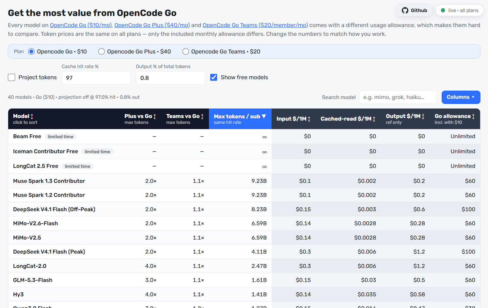

# OpenCode Go — Subscription Cost Comparison

Compares every model on **OpenCode Go ($10/mo)**, **Go Plus ($40/mo)**,
and **Go Teams ($20/member/mo)** side by side. Token prices are identical on
all plans — only the monthly allowance differs.



Live page: single self-contained `index.html` (no build step). It fetches the
latest Go / Go Plus / Go Teams tables from the
[OpenCode Go pricing docs](https://opencode.ai/docs/console/go/) on every load,
caches for an hour, and renders the comparison.

- Plan radio switches all allowance-derived columns.
- Optional **Project tokens** workload reveals the blue-tinted cost columns.
- Default sort is **Max tokens / sub ▼** (largest first = cheapest first).
- Search, column chooser, and all form state persist in localStorage.

## Use

Open directly (`file://`) or serve the folder:

```sh
python -m http.server 8000
# → http://localhost:8000/index.html
```

No prices are stored in the repo — see live fetch behavior below.

## Docs

- [How it works](docs/how-it-works.md) — live fetch, cost formulas, table behavior
- [Developing](docs/developing.md) — add a column, change defaults, styling
- [Testing](docs/testing.md) — syntax, functional, and parser checks
